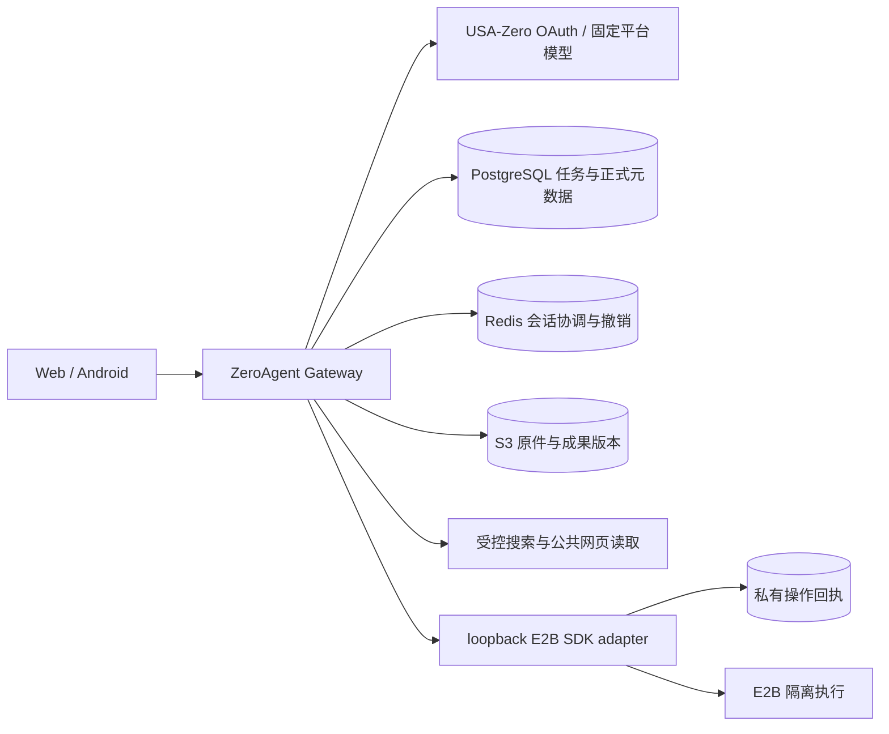

# CloudChat 实施架构

基线：ZeroAgent `b634fefd`，LiveAgent beta.24；依据 ADR 0048。本文随实现证据更新。

## 产品与执行边界

用户在 Web 完成写作、文件理解、联网研究、表格分析、可下载产物、项目接续和编程辅助。体验对标任务完成质量，范围不扩展为复制竞品所有功能。USA-Zero 是唯一账号与模型连接；云端能力和已授权设备分别声明与校验。

## 当前实施

在现有 Gateway 内建立 RunService 和可独立生命周期的 Worker。任务、用户消息与首次事件原子接受。服务端按原会话重新解析模型授权，模型输出先持久化再公开发布。执行租约带代次，过期运行准确中断，不将未知操作重新排队。现有 PostgreSQL 会话/消息是规范历史；新增任务、事件和操作去重数据。Redis 中原有会话不能作为可丢弃缓存。Web 与 Android 共享有序事件协议，Android 使用 Native 有界流式桥。

已接入 S3 兼容对象存储、隔离 PDF/Office 解析、图片视觉输入、Go 唯一工具循环、联网来源快照、项目/显式记忆及不可变成果版本。正式文件和产物独立于沙箱寿命。前端和 SDK 适配层不持有 Agent 循环。模块划分可改进，需保留已承诺结果并记录理由及验证。

Go 按每次调用校验账户和执行代次，工具效果先记录稳定操作 ID，再向 SDK 派发。
SDK 使用固定模板、无自动请求重试和默认禁网，模型/账户/S3 密钥不进入 VM。
Parser 与会话 Workspace 共享账户按日分配预留，未知 create 不通过新 ID 再分配。
长原件仅向模型提供可信元数据，由 `load_uploaded_file` 从 S3 复验并分块载入当前 VM。
`publish_artifact` 从 VM 校验读取，再正式保存到对象存储；只有 ready 版本提供下载。
新会话可以从持久版本载入新 VM，沿同一成果家族生成下一不可变版本。

SDK 本地 journal 从全量 JSON 驻内存调整为私有 SQLite WAL/FULL 持久回执：原实现
2,048 条即满，且分块文件使每条回执可能含 1MiB 原字节，无法支撑持续工作。新实现
按 ID 读取并限制 page cache；Gateway 已持久记录终态后显式确认，回收大结果但永久保留
操作 ID、请求摘要及 scope。再次提交已回收的同 ID 返回 410，不产生第二次执行。
真实进程 SIGKILL/重启、超过旧条数上限、结果回收、越权与重复提交已通过本地测试。
该 SQLite 仅是 SDK 私有执行日志，不替代 PostgreSQL，也不新增产品数据权威。
当前 Gateway/SDK 固定成对路由，不开放未实现的横向多实例调度；扩容前需新的证据和设计。

## 可靠性约束

- 账户从认证会话取得；资源与幂等请求均在账户范围内。
- 接受回执不明确时使用同一请求 ID，不创建第二任务。
- 活跃会话串行写入；编辑、重生、分支原子复制已选历史前缀并保留原对话。
- Worker 租约/代次限制旧进程提交；它不能撤销外部副作用。
- 浏览器断开不取消任务；显式取消、注销、授权失效有界结束执行。
- 事件序号使用十进制字符串；规范历史、累计输出和终态可恢复。
- 流异常和未完成响应不得误标成功；工具结果未知不得盲重试。
- 上游错误正文、账号 token 和模型密钥不公开转发。

## 公开研究与私有综合

研究阶段和综合阶段共用同一个Go任务/循环/预算。公开研究只接用户明确确认的主题，
不加载私有会话、项目指令、记忆、文件或成果；仅可搜索、抓取公共网页及读取本Run来源。
研究阶段的草稿不作为最终答案流出。完成或到达预算边界后，内部出站能力永久撤销，
再加载私有上下文综合。综合阶段即使模型伪造搜索调用也不会派发HTTP。
来源引用及已用额度保持，预算至少为最终综合保留一轮。该隔离补上了单靠SSRF和提示词
无法防止私有资料进入搜索词/URL的缺口；当前授权主题与重试body一起保持幂等。

## 当前外部条件

2026-10-29 已建立本任务独立的真实 PostgreSQL/Redis 并通过存储与竞态合同；生产构建
浏览器通过本地模型/S3/SDK 协议对等服务验证文件、分支、项目、成果下载及跨新会话版本续改。
隔离 Docker 环境已完成 SDK 镜像、容器崩溃恢复、真实 Garage S3 兼容及本地模板候选验收；
备份工具已验证隔离恢复与旧认证撤销。专用外部配置及额度现已到位，真实R2原件完整性、
条件写和清理，以及Tavily搜索→正式原文抓取已通过；真实模型七场景、E2B模板及完整远端
执行正在接续验收。上述局部证据不代表生产部署或最终内容质量。
最新证据、资源使用边界与已复现缺陷见 `PROGRESS.md`。
